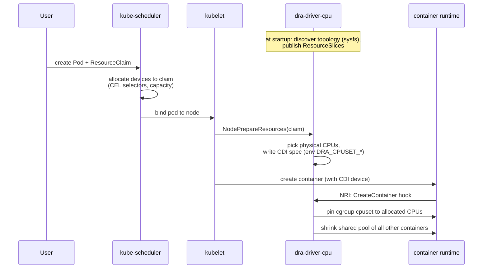

# How it Works

The driver is deployed as a DaemonSet. A single executable implements the DRA
and NRI interfaces, and it owns the node-local CPU allocation state.
Exactly one active driver instance is expected to manage each node.
The driver manages all the available CPUs except those configured as reserved.
The driver manages a single CPU pool, and partitioning that pool is currently
unsupported.
The singleton invariant is not currently enforced by the driver and must be
guaranteed by the deployment.

The lifecycle of a claim, from pod creation to a pinned container:

The two components in detail:

- **DRA driver**: This component is the main control loop and handles the interaction with the Kubernetes API server for Dynamic Resource Allocation.

  - **Topology Discovery**: It discovers the node's CPU topology, including details like sockets, NUMA nodes, cores, SMT siblings, Last-Level Cache (LLC), and core types (e.g., Performance-cores, Efficiency-cores). This is done by reading sysfs files.
  - **ResourceSlice Publication**: Based on the `--cpu-device-mode` flag, it publishes `ResourceSlice` objects to the API server:
    - In `grouped` mode (default), devices represent larger CPU aggregates (like NUMA nodes or sockets). These devices support consumable capacity, indicating the number of available CPUs within that group.
    - In `individual` mode (deprecated), each allocatable CPU becomes a device in the `ResourceSlice`, with attributes detailing its topology.
      This mode is not recommended for new deployments. See [this document](opaque-cpuset-overrides.md#migrate-from-individual-mode) to migrate existing deployments.
  - **Claim Allocation**: When a `ResourceClaim` is assigned to the node, the DRA driver handles the allocation:
    - In `grouped` mode (default), the claim requests a *quantity* of CPUs from the group device. The driver then uses topology-aware allocation logic (imported from [Kubelet's CPU Manager](https://github.com/kubernetes/kubernetes/blob/v1.35.0/pkg/kubelet/cm/cpumanager/cpu_assignment.go)) to select the physical CPUs within the group. Strict compatibility with kubelet's cpumanager or CPU allocation is not a goal of this driver. This decision will be reviewed in the future releases.
    - In `individual` mode (deprecated), the scheduler has already selected specific CPU devices. The driver enforces this selection through CDI and NRI.
  - **CDI Spec Generation**: Upon successful allocation, the driver generates a CDI (Container Device Interface) specification.

- **CDI (Container Device Interface)**: The driver uses CDI to communicate the allocated CPU set to the container runtime.

  - A CDI JSON spec file is created or updated for the allocated claim.
  - This spec instructs the runtime to inject an environment variable (e.g., `DRA_CPUSET_<claimUID>=<cpuset>`) into the container.
  - The `DRA_CPUSET_*` environment variable prefix is reserved for the driver. Containers with malformed `DRA_CPUSET_*` values are rejected during creation.
  - The driver includes mechanisms for thread-safe and atomic updates to the CDI spec files.

- **NRI Plugin**: This component integrates with the container runtime via the Node Resource Interface (NRI).

  - For containers with **guaranteed CPUs** (those with a DRA ResourceClaim), the plugin reads the environment variable injected via CDI and pins the container to its exclusive CPU set using the cgroup cpuset controller.
  - For all other containers, it confines them to a **shared pool** of CPUs, which consists of all allocatable CPUs not exclusively assigned to any guaranteed container.
  - It dynamically updates the shared pool cpuset for all shared containers whenever guaranteed allocations change (containers are created or removed).
  - On restart, the NRI plugin can synchronize its state by inspecting existing containers and their environment variables to rebuild the current CPU allocations.

## Surviving node reboots, restarts and pod recreation

The driver keeps the CPU allocation state in memory and uses CDI to hand the allocated CPUs to the container runtime. That shapes what happens to running workloads when the node, the kubelet or the driver restarts.

- **The CDI spec files are node-local and volatile.** For every prepared claim the driver writes a CDI spec file carrying the allocated CPU set into the CDI spec directory the container runtime reads (see [installation](installation.md)). That directory is mounted from the node, and it can sit on a tmpfs, so the spec files do not survive a node reboot. The runtime resolves the CDI device from those files, so the driver has to write the missing ones again before the containers can be created.

- **A node reboot re-prepares every affected claim.** Kubelet does not cache the "is prepared" flag in its checkpoint file and calls `NodePrepareResources` again after a reboot ([kubernetes/kubernetes#141966](https://github.com/kubernetes/kubernetes/pull/141966)). The driver therefore rebuilds the CDI spec on the prepare path and the pods come back on their own, without recreating the workload or the claim.

- **Restarting only the kubelet is not the same thing.** Kubelet keeps the claim's devices and CDI device IDs in its DRA manager state, so a kubelet service restart does not call `NodePrepareResources` again and does not recreate the containers. The second prepare call is tied to a node reboot or to a pod being re-admitted, not to every kubelet process restart.

- **Restarting only the driver is transparent to the workloads.** A driver restart, such as a DaemonSet rollout, does not make kubelet prepare the claim again and does not recreate any container: the CDI spec files are still on disk and the containers keep their CPUs. The driver rebuilds its in-memory allocation state from the CDI environment variables of the containers that are already running (see the NRI plugin above).

- **Deleting and recreating a pod releases and re-acquires the claim.** Deleting the pod makes kubelet call `UnprepareResourceClaims`, which removes the CDI spec and frees the CPUs. Creating a pod again against the same `ResourceClaim` prepares the claim from scratch. In `grouped` mode the claim fixes the group and the number of CPUs while the driver picks the concrete CPUs when it prepares the claim, so the same CPUs are the normal outcome rather than a guarantee: they can differ when the free pool is not the same as before.

Preparing a claim the driver has already prepared is safe, and is what makes the reboot path work: the driver reuses the CPUs it recorded and rewrites the CDI spec. In `individual` mode, where the CPUs are part of the claim's allocation, a repeated prepare that asks for a different set is rejected instead.
